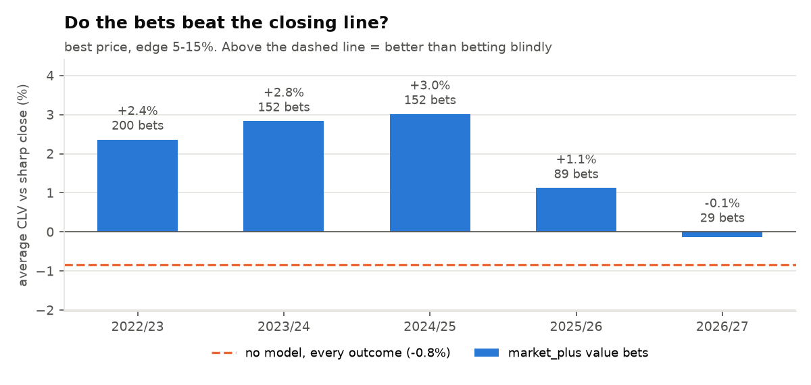

# La Liga Match Predictor

Can a data science model find mispriced odds in Spanish football?

This project forecasts La Liga results (home / draw / away) with nine models,
tests them the way they would really be used (walk-forward, never peeking at
the future), and measures them against the **sharp closing odds**, the hardest
benchmark in sports forecasting. It then looks for value bets and judges them
by **closing line value**: did the bet get a better price than the market's
final, best-informed opinion?

**Results in one paragraph.** No model forecasts results better than the
closing line. But a model that starts from the sharp *opening* odds and adds
Dixon-Coles and Elo signals, combined with line shopping, picks bets that beat
the sharp closing line by **+2.3% on average (68% of bets)**. Picking at random
at the same prices gives **−0.8%**. The edge holds in four of five test seasons
and fades after Pinnacle odds vanish from the data in 2026. Realised profit is
still within the range of luck (ROI +0.3%, 95% interval −12% to +13% over
622 bets), so this is a promising signal, not proven profit.



## Why not just report accuracy?

The home team wins about 45% of La Liga games and the bookmaker's favourite
about 50%, so "52% accuracy" says nothing. For betting, what matters is:

1. **Probability quality**: log loss and Brier score against the
   margin-free sharp closing odds (Pinnacle, or the Betfair Exchange once
   Pinnacle odds stop in January 2026).
2. **Closing line value (CLV)**: `bet odds × fair closing probability − 1`.
   A bettor whose bets consistently beat the sharp closing line has an edge;
   one who doesn't is getting lucky or unlucky. Over a few hundred bets CLV is
   far less noisy than profit.

## Results (walk-forward, 2022/23 to 2026/27, 1,628 matches)

### 1. Forecast quality

| Model | Uses market odds | Log loss | Gap to closing line |
|---|---|---|---|
| **Sharp closing odds (benchmark)** | – | **0.9556** | – |
| `market`: opening odds, recalibrated | yes | 0.9575 | +0.0019 |
| `market_plus`: opening odds + Dixon-Coles + Elo | yes | 0.9576 | +0.0020 |
| `ensemble`: Dixon-Coles + Elo + shots, stacked | no | 0.9727 | +0.0171 |
| `logistic_shots`: Elo, form, rolling shots | no | 0.9758 | +0.0202 |
| `dixon_coles`: time-decayed Poisson | no | 0.9762 | +0.0205 |
| `logistic`: Elo + form | no | 0.9774 | +0.0218 |
| `lgbm_shots` | no | 0.9802 | +0.0245 |
| `lgbm` | no | 0.9841 | +0.0284 |


- Stacking Dixon-Coles, Elo and shots (`ensemble`) is the best football-only
  model, 0.0047 better than the plain logistic baseline.
- The opening market is already almost as good as the close. Football
  information adds nothing measurable to it on average (0.9575 vs 0.9576), and
  adding shot statistics to the market made it *worse* (0.9612), so they are
  left out of `market_plus`.
- `market_plus` beats the closing line in two seasons (2023/24: 0.9491 vs
  0.9509; 2025/26: 0.9636 vs 0.9646).

### 2. Finding value

Value bet: the outcome with the highest expected value, when
`p_model × odds − 1` is between 5% and 15%. Edges above 15% are skipped: when a
model disagrees that much with the market, the model is usually wrong.

| Strategy (flat stakes, edge 5–15%) | Bets | ROI (95% interval) | CLV vs sharp close | Bets beating it |
|---|---|---|---|---|
| **`market_plus`, best price** | 622 | **+0.3%** (−12% to +13%) | **+2.3%** | **68%** |
| `market_plus`, one bookmaker | 195 | −15.4% (−35% to +5%) | −2.0% | 26% |
| `ensemble`, best price | 713 | +0.1% (−10% to +11%) | −1.1% | 45% |
| `dixon_coles`, one bookmaker | 541 | −12.0% (−25% to +3%) | −4.2% | 29% |
| No model, every outcome, best price | all | – | −0.8% | – |
| No model, every outcome, one bookmaker | all | – | −3.8% | – |

| Season | Bets | ROI | CLV vs sharp close | Bets beating it |
|---|---|---|---|---|
| 2022/23 | 200 | −3.5% | +2.4% | 71% |
| 2023/24 | 152 | −3.3% | +2.8% | 74% |
| 2024/25 | 152 | +10.7% | +3.0% | 72% |
| 2025/26 | 89 | −9.8% | +1.1% | 52% |
| 2026/27 (so far) | 29 | +20.7% | −0.1% | 48% |

**What this means**

- **The detection signal is real.** The model's bets beat the closing line
  by 3.1 points more than random bets at the same prices. In 500 simulations
  of 622 random bets, even the luckiest 2.5% only reached −0.2%.
- **Line shopping matters as much as the model.** The same model at a single
  bookmaker is negative: you need its edge *and* the best price.
- **Profit is not proven.** ROI is within the range of luck. In theory,
  positive CLV turns into profit over enough bets; paper trading will tell.
- **Profit without CLV is luck.** `lgbm` at one bookmaker shows +10% ROI in
  the backtest, but its bets lose 3.9% to the closing line: worse than betting
  blindly. That profit would not last.
- **The edge depends on a sharp opening price.** It faded once Pinnacle odds
  stopped appearing in the data (Jan 2026) and the model fell back to Betfair
  Exchange and market-average prices.
- **The best-price column is optimistic.** In 40% of matches the best prices
  across bookmakers add up to less than 100%, which means some of them are
  stale or come from bookmakers that limit winning customers. Treat best-price
  results as an upper bound.


With quarter-Kelly staking the same strategy ends at 98 from a bankroll of
100 (largest drawdown 24%). The first version of this project, betting
Dixon-Coles at one bookmaker, ended at 4.

<p>


</p>

## How it works

```
download → clean → features → models → walk-forward test → evaluate → backtest → predict → settle
```

1. **Data** (`src/data.py`). Results, odds and match statistics since 2012/13
   from [football-data.co.uk](https://www.football-data.co.uk). For each match:
   - bet odds and closing odds from the **same** bookmaker (Pinnacle, else
     Bet365), so like-for-like CLV is possible;
   - the **best price** across bookmakers (`Max`, `BbMx` before 2019);
   - **sharp pre-match odds** (Pinnacle → Betfair Exchange → average);
   - the **benchmark** closing odds (Pinnacle → Betfair Exchange → average);
   - shots and shots on target.
2. **xG** (`src/xg.py`). Expected goals from [Understat](https://understat.com),
   cached and mapped to football-data team names. Optional: Understat was
   unreachable throughout development, so the xG models switch on
   automatically once it is back.
3. **Features** (`src/features.py`), computed in one chronological pass so each
   match only sees the past:
   - Elo with home advantage, goal-margin weighting, summer regression and a
     lower start for promoted (or returning) teams
   - last-5 form: goals for, goals against, points
   - rolling shots and shots on target, for and against (last 8 games)
   - rolling xG (when available)
4. **Model inputs built from other models** (`src/model.py`)
   - **Dixon-Coles** probabilities for every match, from weekly refits that only
     see earlier matches, so they can feed other models without leakage.
   - **Market** probabilities from the sharp pre-match odds, which are
     published before kickoff.
5. **Models**: logistic regression, LightGBM, Dixon-Coles (exact gradients,
   time decay, promoted-team prior), a stacked `ensemble`, and the
   market-aware `market` / `market_plus`.
6. **Walk-forward testing**: for each test season, train only on earlier
   seasons. Never a random split.
7. **Backtest** (`src/backtest.py`): value bets at one bookmaker or the best
   price, flat or quarter-Kelly stakes, like-for-like CLV, CLV against the
   sharp close, a no-model control, per-season breakdown and bootstrap
   intervals for ROI.
8. **Paper trading**: `predict` logs value bets on games that haven't kicked
   off (each pairing once per season, at the first price seen); `settle` adds
   results, closing odds and CLV, also for postponed games.

## Usage

```bash
python -m venv .venv
.venv\Scripts\activate            # macOS/Linux: source .venv/bin/activate
pip install -r requirements.txt

python run.py download            # results, odds, Understat xG, upcoming fixtures
python run.py evaluate            # walk-forward test of every model -> reports/  (~1 min)
python run.py predict             # value bets for upcoming games (market_plus, best price)
python run.py settle              # results + CLV for logged paper trades
streamlit run app.py              # dashboard
pytest                            # 140 tests
```

Options: `predict --model ensemble --price book --min-edge 0.03 --max-edge 0.2`,
`evaluate --models market market_plus dixon_coles`, `download --no-xg`.

**Daily run.** `scripts/daily.ps1` (Windows) and `scripts/daily.sh` (macOS/Linux)
run download → predict → settle and append to `reports/daily.log`. The
scheduling command is in each script's header.

## Outputs (`reports/`)

| File | Contents |
|---|---|
| `model_comparison.csv` | Every model vs the closing line, pooled over test seasons |
| `probability_metrics.csv` | Log loss and Brier per model per season |
| `backtest_summary.csv` | Every strategy: bets, ROI with 95% interval, CLV, drawdown |
| `strategy_by_season.csv` | The main strategy season by season |
| `control_clv.csv` | CLV of betting blindly, the bar to beat |
| `calibration.csv` | Reliability-diagram data |
| `predictions.csv` | Every out-of-sample prediction, every model |
| `upcoming.csv` | Latest predictions for upcoming fixtures |
| `paper_trades.csv` / `paper_trades_settled.csv` | Paper-trade log, and the same with results and CLV |
| `*.png` | Charts (also copied to `docs/img/` for this README) |

## Project structure

```
run.py              command-line entry point
app.py              Streamlit dashboard
src/data.py         download, cleaning, bookmaker selection, best price, stats
src/xg.py           Understat download, cache, team-name mapping, merge
src/features.py     Elo, form, rolling shots and xG (leakage-free single pass)
src/model.py        model registry, stacked inputs, walk-forward, metrics, calibration
src/dixon_coles.py  Dixon-Coles model
src/backtest.py     value bets, staking, CLV, control, bootstrap, paper-trade settling
src/plots.py        report charts
scripts/            daily update scripts
tests/              pytest suite on a synthetic league
```

## Testing

`pytest` runs 140 tests on a synthetic league that copies the quirks of the
real data: two- and four-digit years, a byte-order mark, Pinnacle odds stopping
mid-season, relegated teams returning, a half-played season. Among other
things they check that:

- no feature, and no Dixon-Coles input, can see the match it describes or
  any later one;
- Dixon-Coles gradients match numerical ones;
- walk-forward never trains on the test season;
- CLV only compares like with like, and fair CLV uses the sharp close;
- paper trades are logged once and settled against the right game.

The suite was written by a separate testing agent that only reported bugs; a
correcting agent then fixed the ten it found.

## Limitations

- Best prices are an optimistic upper bound (see above), and bookmakers limit
  accounts that consistently beat the closing line.
- The main model was chosen after seeing these test seasons. Its rules are
  simple (four inputs, one logistic regression) and the control comparison
  doesn't depend on that choice, but a truly fresh test is the paper trading
  from November 2026 onward.
- Since Pinnacle odds disappeared from the data, the market input is weaker,
  and so is the signal.
- xG models have not been evaluated on real data (Understat unreachable).

## Disclaimer

Educational project. A positive CLV backtest is not a guarantee of profit.
Paper-trade before ever risking money, and never bet more than you can afford
to lose.
