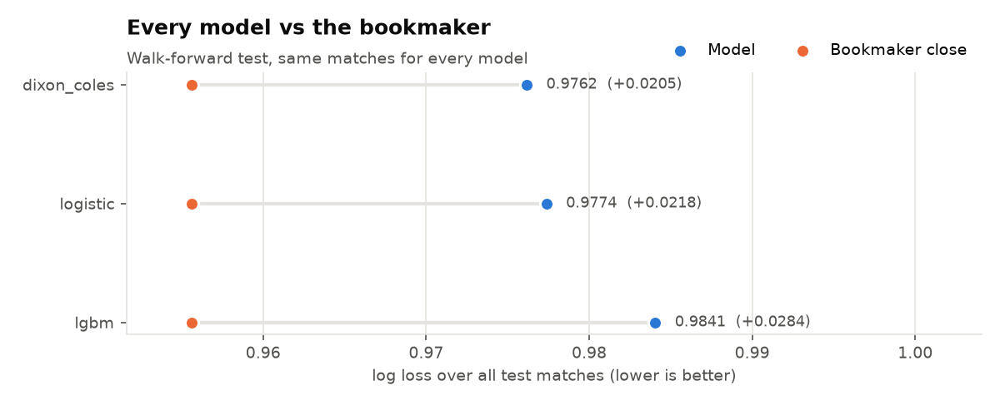
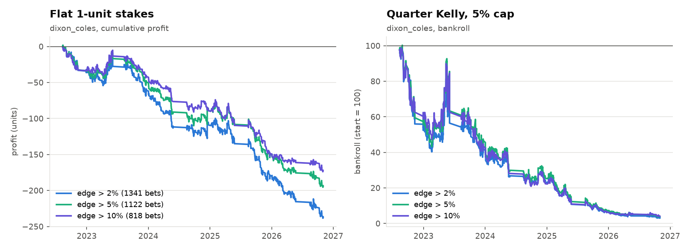
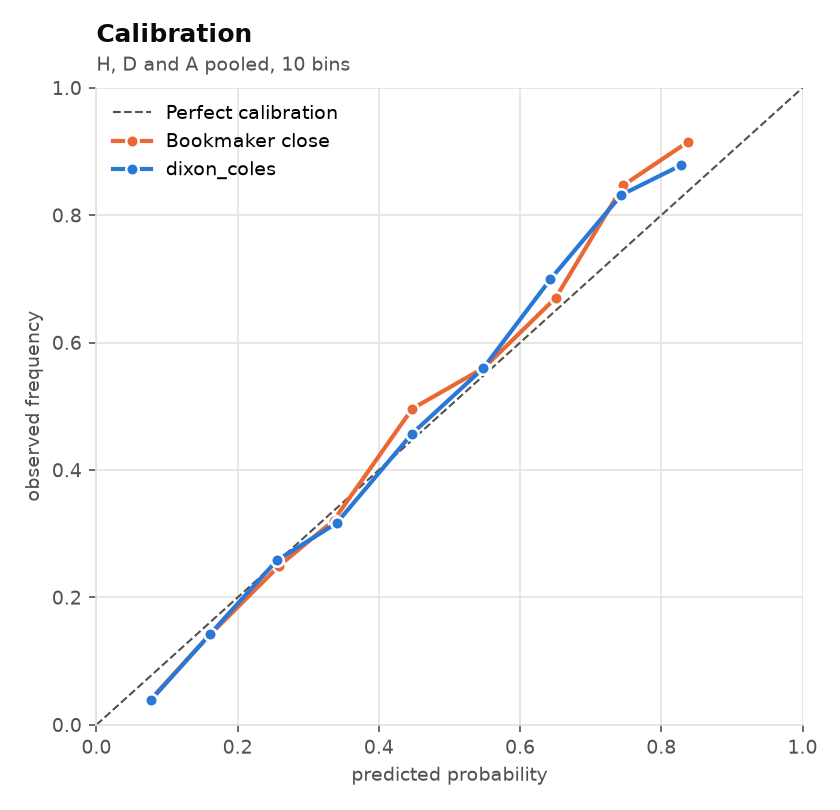
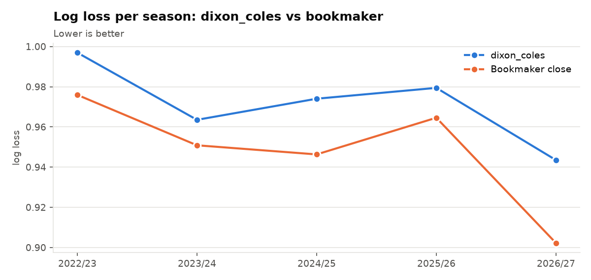

# La Liga Match Predictor

Can a data science model beat the betting market on Spanish football?

This project predicts La Liga results (home / draw / away) with three models,
tests them the way they would really be used (walk-forward, no peeking at the
future), and compares them with the **bookmaker's closing odds**, the hardest
benchmark in sports forecasting. It then paper-trades the model's "value bets"
to see whether any edge survives contact with real prices.

**Short answer so far: no.** The best model is about 0.02 log loss behind the
market. This README shows how that was measured and why it matters.



## Why not just report accuracy?

The home team wins about 45% of La Liga games and the bookmaker's favourite
wins about 50%, so "52% accuracy" says nothing. What matters for betting is
whether the model's **probabilities** are better than the market's. The project
therefore judges every model by:

- **Log loss** and **Brier score** against the margin-free closing odds
  (Pinnacle, or the Betfair Exchange once Pinnacle odds stop in Jan 2026).
- **Closing line value (CLV)** of its bets: did we get a better price than the
  final market price at the same bookmaker? Over hundreds of bets, CLV is a much
  less noisy signal of a real edge than profit.

## Results (walk-forward, 2022/23 to 2026/27, 1,628 matches)

| Model | Log loss | Brier | Gap to market (log loss) |
|---|---|---|---|
| Bookmaker closing odds | **0.9556** | **0.5668** | – |
| Dixon-Coles (Poisson, time-decayed) | 0.9762 | 0.5800 | +0.0205 |
| Logistic regression (Elo + form) | 0.9774 | 0.5798 | +0.0218 |
| LightGBM (Elo + form) | 0.9841 | 0.5843 | +0.0284 |

Value betting with the best model (Dixon-Coles):

| Strategy | Bets | Hit rate | ROI | Avg CLV | Beat the close |
|---|---|---|---|---|---|
| Flat stakes, edge > 5% | 1,122 | 25.8% | −17.3% | −0.9% | 41% |
| Quarter Kelly, edge > 5% | 1,122 | 25.8% | −13.0% on turnover; bankroll 100 → 3.9 | −0.9% | 41% |



**What this means**

- No model beats the market in any season. The market already knows
  everything in Elo and goal-based form, plus injuries, line-ups and the money of
  professional bettors.
- The "value bets" are mostly model errors: bigger disagreements with the market
  lose *more*, and only 41% of bets beat the closing price.
- Kelly staking amplifies whatever edge you have. With a negative edge it loses
  the bankroll faster than flat stakes do, which is a useful lesson in itself.
- The models are still well calibrated (below), so they are reasonable
  forecasts, just not better than the market's.

<p>


</p>

## How it works

```
download → clean → features → models → walk-forward test → evaluate → backtest → predict → settle
```

1. **Data** (`src/data.py`). Results and odds since 2012/13 from
   [football-data.co.uk](https://www.football-data.co.uk). For each match, bet
   odds and closing odds come from the **same** bookmaker (Pinnacle, else
   Bet365), so CLV is like-for-like. A separate benchmark uses the sharpest
   closing price available (Pinnacle → Betfair Exchange → market average).
2. **xG** (`src/xg.py`). Expected goals from [Understat](https://understat.com)
   (2014/15 on), cached per season and mapped to football-data team names.
   Optional: if Understat is unreachable, xG models are skipped.
3. **Features** (`src/features.py`), computed in one chronological pass so each
   match only sees the past:
   - Elo with home advantage, goal-margin weighting, summer regression to the
     mean, and a lower start for promoted (or returning) teams
   - last-5 form: goals for, goals against, points
   - rolling xG for and against over the last 8 games (when available)
4. **Models** (`src/model.py`, `src/dixon_coles.py`)
   - multinomial logistic regression (baseline)
   - LightGBM with small, regularised trees
   - Dixon-Coles: Poisson goals with a low-score correction, exponential time
     decay (half-life about a year), ridge prior that starts promoted teams below
     average, exact gradients, refitted every week of the test
5. **Walk-forward testing**: for each test season, train only on earlier
   seasons. Never a random split.
6. **Backtest** (`src/backtest.py`): bet the highest-EV outcome when
   `p × odds − 1 > edge`; flat stakes or quarter Kelly (capped at 5% of the
   bankroll, sized from the bankroll at the start of each match day).
7. **Paper trading**: `predict` logs value bets on games that haven't kicked off
   (each pairing once per season, at the first price seen); `settle` adds
   results and closing odds, also for postponed games.

## Usage

```bash
python -m venv .venv
.venv\Scripts\activate            # macOS/Linux: source .venv/bin/activate
pip install -r requirements.txt

python run.py download            # results, odds, Understat xG, upcoming fixtures
python run.py evaluate            # walk-forward test of every model -> reports/
python run.py predict             # upcoming games + value bets (default: Dixon-Coles)
python run.py settle              # results + CLV for logged paper trades
streamlit run app.py              # dashboard
pytest                            # tests
```

Useful options: `evaluate --models logistic dixon_coles`, `evaluate --model logistic`
(model used for the backtest and charts), `predict --model lgbm --min-edge 0.08`,
`download --no-xg`.

**Daily run.** `scripts/daily.ps1` (Windows) and `scripts/daily.sh` (macOS/Linux)
run download → predict → settle and append to `reports/daily.log`. The
scheduling command is in each script's header.

## Outputs (`reports/`)

| File | Contents |
|---|---|
| `model_comparison.csv` | Every model vs the market, pooled over test seasons |
| `probability_metrics.csv` | Log loss and Brier per model per season |
| `backtest_summary.csv` | Bets, hit rate, ROI, CLV, drawdown, flat and Kelly |
| `calibration.csv` | Reliability-diagram data |
| `predictions.csv` | Every out-of-sample prediction, every model |
| `upcoming.csv` | Latest predictions for upcoming fixtures |
| `paper_trades.csv` / `paper_trades_settled.csv` | Paper-trade log, and the same with results and CLV |
| `*.png` | Charts (also copied to `docs/img/` for this README) |

## Project structure

```
run.py              command-line entry point
app.py              Streamlit dashboard
src/data.py         download, cleaning, bookmaker selection, fair probabilities
src/xg.py           Understat download, cache, team-name mapping, merge
src/features.py     Elo, form, rolling xG (leakage-free single pass)
src/model.py        model registry, walk-forward, metrics, calibration
src/dixon_coles.py  Dixon-Coles model
src/backtest.py     value bets, flat and Kelly staking, CLV, paper-trade settling
src/plots.py        report charts
scripts/            daily update scripts
tests/              pytest suite (115 tests, synthetic league data, ~25 s)
```

## Testing

`pytest` runs 115 tests on a synthetic league that copies the quirks of the
real data: two- and four-digit years, a byte-order mark, Pinnacle odds stopping
mid-season, relegated teams returning, a half-played season. They check, among
other things, that no feature can see the match it describes or any later one,
that Dixon-Coles gradients match numerical ones, that walk-forward never trains
on the test season, that CLV only compares prices from the same bookmaker, and
that paper trades are logged once and settled against the right game.

## Data notes and limitations

- Pinnacle odds stop in the football-data.co.uk files after 12 Jan 2026, so
  later bets are priced at Bet365 (a softer bookmaker with a ~5–7% margin) and
  the benchmark switches to Betfair Exchange closing odds.
- Understat was unreachable during development (DNS failure), so the xG models
  have not yet been evaluated on real data. The code is tested with simulated
  Understat responses and switches on automatically once the data downloads.
- The best model is chosen on the same test seasons it is reported on, a mild
  optimistic bias. The ranking is close, and none of the models beats the market
  either way.
- 2026/27 is only 108 matches so far; its numbers are noisy.

## Ideas for further work

- Evaluate the xG models once Understat is back.
- Blend the model with the opening market price: does it add *anything* the
  opening line doesn't already know?
- Line-up and injury information close to kickoff.
- Other markets (over/under goals) from the Dixon-Coles score matrix.

## Disclaimer

Educational project. Bookmakers are hard to beat, and this model does not beat
them. Paper-trade before ever risking money.
